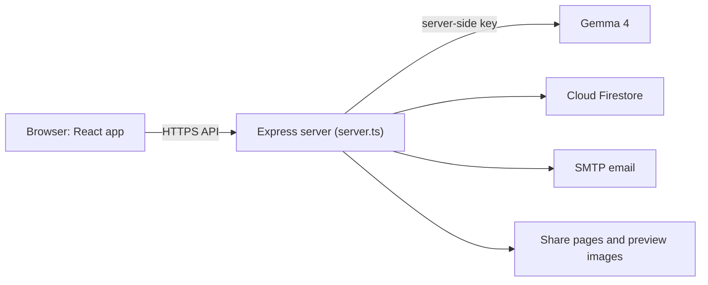

# Matchpiece

*Find your missing piece.*

Matchpiece helps builders, creators, professionals, business people and students anywhere in the world find the people they should build and learn with, matched by what each person needs and what they offer. It also runs events, from the event page and registration to tickets and check-in.

**Live app:** https://matchpiece.ai.studio

[](https://github.com/Saifuddin2Ahmed/matchpiece/actions/workflows/ci.yml)
[](#story)
[](https://ai.google.dev/gemma/docs/core)
[](./LICENSE)
[](https://doi.org/10.5281/zenodo.23737410)

---

## Contents

- [Why Matchpiece](#why-matchpiece)
- [Features](#features)
- [Story](#story)
- [Team](#team)
- [How it works](#how-it-works)
- [Run locally](#run-locally)
- [Contributing](#contributing)
- [Deployment](#deployment)
- [Acknowledgements](#acknowledgements)
- [License](#license)

---

## Why Matchpiece

**The problem.** At hackathons, meetups, workplaces and online communities, the developer and the business person who need each other are often in the same room and never speak. Networking still depends on luck and on the people you arrived with, and most platforms rank people by popularity rather than by whether they can actually help each other.

**The solution.** Each member says what they need and what they offer. Matchpiece writes a short profile from those facts and suggests people whose offer meets your need and whose need you can meet. One tap opens a WhatsApp chat. Organisers use the same app to run events.

---

## Features

### For members

- **Chat onboarding.** A short conversation, one question at a time, collects your roles, what you offer, what you need, what you want to learn and what you can teach. You can add a public GitHub username and Matchpiece reads your public repositories and languages.
- **AI profile from your own facts only.** Gemma 4 writes a headline, a short bio and skill tags using only what you entered. You can accept it or ask for a new version.
- **Complementary matching.** Matches are ranked by how well one person's offer covers the other's need, in both directions, not by surface similarity. If the model is unavailable, a built-in ranking based on the same idea is used.
- **People directory.** Browse and filter members by role, and follow people.
- **Shareable profile links with previews.** Every profile has a public link with its own share image, so it shows a proper preview in chat apps and on social networks.
- **WhatsApp connect.** Start a WhatsApp conversation with a match in one tap. WhatsApp numbers are visible to signed-in members by design; anonymous visitors never see them, and each member can hide their number.
- **Feed.** Post asks, offers and questions. Gemma suggests topic tags for each post.
- **Learn.** Suggests a peer mentor who can teach what you want to learn and a study partner learning the same thing.

### For event organisers

- **Event page and share preview.** Each event has its own page and share image.
- **Member and guest registration.** Members register with one tap; guests register with a name and email, without an account.
- **Confirmation email with calendar links.** Every registration gets an email with the details, a ticket link and Google Calendar and `.ics` links.
- **Cancel registration.** Members and guests can cancel their own registration.
- **Waitlist auto-promotion.** When an event is full, people join a waitlist and move up automatically when a place opens.
- **QR tickets and check-in.** Each registration has a signed QR ticket. Hosts scan tickets at the door, and attendees can also check themselves in.
- **Cancellation emails.** People are emailed when their registration is cancelled or when the host cancels the event.

---

## Story

Matchpiece, formerly Kwegatta, was built at **Hacktoberfest 2026 Hack Day Kampala × MUBS** (Makerere University Business School), where 67 participants built 8 projects. It was entered in the **Best Open-Source AI Project** challenge, won **1st place**, and was forwarded to the **MUBS EIIC** (Entrepreneurship, Innovation and Incubation Centre) incubator.

---

## Team

| Name | Role | University | GitHub |
| ---- | ---- | ---------- | ------ |
| Saifuddin Ahmed | Project Lead & Developer | Al Neelain University | [@Saifuddin2Ahmed](https://github.com/Saifuddin2Ahmed) |
| Abubaker Mohamed Adam | QA & Testing Lead | Sub-Saharan College | [@abubakermohammed092077-bit](https://github.com/abubakermohammed092077-bit) |
| Adinan Juuko | Technical Support | Victoria University | [@Aditech-191](https://github.com/Aditech-191) |
| Amme Patience Esther | Marketing & Communications | Makerere University Business School | — |
| Mupole Uwizeye Alexis | UI/UX & Brand Design | Bugema University | [@Alexis-Mupole](https://github.com/Alexis-Mupole) |
| Nabagulanyi Prossy Sherry | Student Outreach | Makerere University Business School | — |
| Ojambo Emmanuel | Finance & Operations | Makerere University Business School | — |

---

## How it works

### Open-weight model

All AI features (profile writing, matching, learning suggestions and post tags) use Google DeepMind's open-weight **Gemma 4** models: `gemma-4-26b-a4b-it` by default, with `gemma-4-31b-it` as the alternative. Gemma 4 is released under the [Apache 2.0 licence](https://www.apache.org/licenses/LICENSE-2.0) ([model documentation](https://ai.google.dev/gemma/docs/core)). The model is called only from the server, so the API key never reaches the browser. Prompts tell the model to use only facts the member provided. Details are in [docs/AI-USAGE.md](docs/AI-USAGE.md).

### Privacy controls

- **Export:** members can download all their data as a JSON file from their profile.
- **Delete:** members can permanently delete their profile together with their posts, matches and notifications.
- **No ad trackers:** the app loads no advertising or analytics trackers.

See [PRIVACY.md](PRIVACY.md) for the full policy.

### Tech stack

- **Frontend:** React 19, TypeScript, Vite, Tailwind CSS, Lucide icons; installable as a web app
- **Backend:** Node.js 22, Express
- **Data and sign-in:** Cloud Firestore and Firebase Authentication
- **AI:** Gemma 4 through `@google/genai`, on the server
- **Other:** Nodemailer (email), `qrcode` (tickets), `sharp` (images)

### Architecture



One Express server serves the built React app, the JSON API, the share pages for profiles and events, and their preview images. It keeps data in memory, writes changes to Firestore, and stays in sync through Firestore listeners. More detail is in [docs/ARCHITECTURE.md](docs/ARCHITECTURE.md).

---

## Run locally

Requirements: Node.js 22 or newer, npm, and a Google AI Studio API key for Gemma.

```bash
git clone https://github.com/Saifuddin2Ahmed/matchpiece.git
cd matchpiece
npm ci
cp .env.example .env    # then set GEMINI_API_KEY in .env
npm run dev
```

Open http://localhost:3000. Set `DEMO_MODE="true"` in `.env` to load sample members. If the server cannot reach Firestore during development, it keeps data in a local file (`.kwegatta_store.json`). All settings are described in [.env.example](.env.example).

Check, test and build:

```bash
npm run lint
npx vitest run
npm run build
```

---

## Contributing

Contributions are welcome. Please read [CONTRIBUTING.md](CONTRIBUTING.md) and the [Code of Conduct](CODE_OF_CONDUCT.md) first. Report security issues as described in [SECURITY.md](SECURITY.md). Changes are listed in [CHANGELOG.md](CHANGELOG.md).

---

## Deployment

Matchpiece runs on Google Cloud Run in `us-west1`. In production the server needs Cloud Firestore and stops at startup if it cannot reach it. Keep secrets in Secret Manager, never in the command line or the repository. The example below uses placeholders:

```bash
npm ci && npm run build

gcloud run deploy YOUR_SERVICE \
  --source . \
  --region us-west1 \
  --allow-unauthenticated \
  --update-secrets GEMINI_API_KEY=YOUR_GEMINI_SECRET:latest,SMTP_PASS=YOUR_SMTP_SECRET:latest,TICKET_HMAC_SECRET=YOUR_TICKET_SECRET:latest \
  --update-env-vars PUBLIC_SHARE_URL=https://your-domain.example,SMTP_USER=you@example.com
```

Event emails are sent from `EMAIL_FROM` when it is set, otherwise from `SMTP_USER`. Replies go to the event's contact email when it has one, otherwise to the optional `EMAIL_REPLY_TO`, then to the `EMAIL_FROM` address, then to `SMTP_USER`. A Brevo SMTP login (an address ending in `smtp-brevo.com`) is never used as the reply address.

Use `--update-env-vars` and `--update-secrets` so that settings already on the service are kept. To move an old address to a new one, set `LEGACY_HOSTS` and `PRIMARY_URL` on the service behind the old address (see [.env.example](.env.example)).

---

## Acknowledgements

Thanks to **Web3 Club MUBS** and **GDG on Campus MUBS** for hosting Hack Day Kampala, to **MLH** and **DEV** for organising Hacktoberfest 2026, to **DigitalOcean** for presenting it, and to **Google DeepMind** for releasing Gemma 4 as an open-weight model.

---

## License

Matchpiece is released under the [MIT License](LICENSE). Gemma 4 is developed by Google DeepMind and released under the [Apache 2.0 licence](https://www.apache.org/licenses/LICENSE-2.0).
